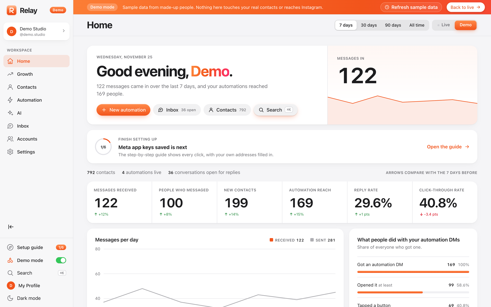

# Demo mode

Demo mode fills the whole Relay console with **made-up sample data**, so you (or anyone you show it to) can click
through every page before connecting Instagram, or anytime after, without touching your real data.



---

## Turn it on or off: one click

Look at the **top right** of any page. You'll see a switch with two sides:

| | What you see |
|---|---|
| **● Live** | Your real data: your real contacts, DMs, automations and numbers. |
| **Demo** | Sample data from invented people. An orange banner across the top tells you you're in demo. |

Click the side you want. That's it. You stay on the same page, so you can compare Live and Demo side by side.

Three other ways to switch, all doing the same thing:
- **Demo mode** toggle near the bottom of the sidebar
- **Back to live →** in the orange banner (while you're in demo)
- Press **⌘K** (Mac) or **Ctrl+K** (Windows), type `demo`, press **Enter**

Your choice is remembered in this browser. Someone else logging in on another computer starts on Live.

---

## What's safe in demo mode

You can't break anything. Click, edit, publish and delete as much as you like.

- **Your real data is never touched.** Demo data lives in its own separate database. Your real contacts, conversations
  and automations are in a different one, and demo mode doesn't read or write it.
- **Nothing reaches Instagram.** The demo has no Instagram connection, and sending is switched off in demo. No DM, reply
  or comment can go out.
- **Your real automations keep running.** Instagram's messages, comments and the every-minute background jobs always
  use your real database, whether demo is on or off in your browser.

## What's in the sample data

| Page | Sample |
|---|---|
| **Home** | About 45 days of DMs, people reached, reply and click-through rates |
| **Growth** | 60 days of follower counts, reach, views, posts, and people who followed after a DM |
| **Contacts** | Around 800 invented people with tags (names are random mixes like "Maya Park") |
| **Automation** | Six automations: comment keywords, a story reply, a DM keyword and a draft |
| **Inbox** | Conversations with buttons tapped, links opened and replies |

None of these people exist. The sample account is called **Demo Studio** (@demo.studio).

## Refresh the sample data

Sample dates are set relative to when the demo was filled. To make them recent again (or to undo anything you changed
while trying things out), click **Refresh sample data** in the orange banner. It takes a few seconds.

Relay also refreshes the demo on its own once a week, so the dates never look stale.

---

## Try it without an Instagram account

This is the fastest way to see Relay. You only need [Node.js 22+](https://nodejs.org) and two minutes.

```bash
git clone https://github.com/abrhamhabtu/relay-manychat-clone.git
```

```bash
cd relay-manychat-clone
```

```bash
npm install
```

```bash
npm run preview
```

Then open **http://localhost:8791/login**. The password is the `ADMIN_PASSWORD` line in the `.dev.vars` file the
preview creates in the folder. The preview **opens in demo mode**. Flip to **Live** to see what a brand-new, empty
install looks like.

Press `Ctrl + C` in the terminal to stop it. To start over with fresh data: `npm run preview -- --reset`.

---

## On your live Relay (Cloudflare)

`npm run setup` creates the demo database for you, next to your real one, and fills it. Nothing else to do.

**Set up before demo mode existed?** Run this once in your Relay folder. It adds the demo database and puts the new
version live:

```bash
npm run update
```

**Switch greyed out?** That means the demo database isn't there yet (for example, Cloudflare refused to create it).
Everything else works normally. Run `npm run setup` again and it tries once more.

---

## For developers

- Code: `src/demo.ts` (the switch, the refresh, the safety swaps) and `src/demo_seed.js` (the sample data, shared by the
  Worker, `npm run setup` and `npm run preview`).
- The choice is a cookie, `relay_demo=on|off`. Console requests in demo run with `env.DB` pointed at the `DEMO_DB`
  binding, a send queue that drops jobs, and live updates off. Webhooks, the cron and Instagram login never look at the
  cookie.
- The Setup guide's checks always read the real database, even in demo.
- `DEMO_DEFAULT=on` (in `.dev.vars`) starts a browser in demo when it hasn't chosen yet. The preview sets it.
- Tests: `test/demo.test.ts`.
